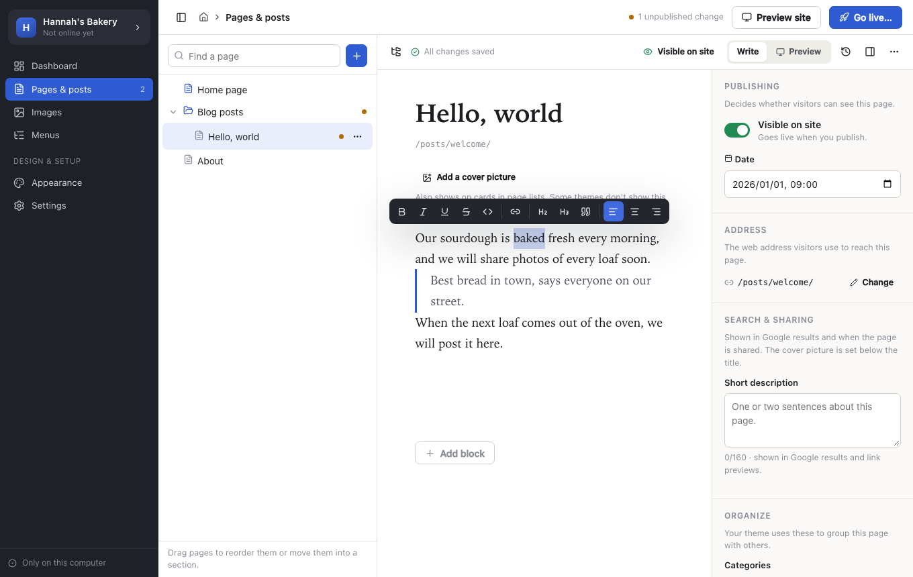
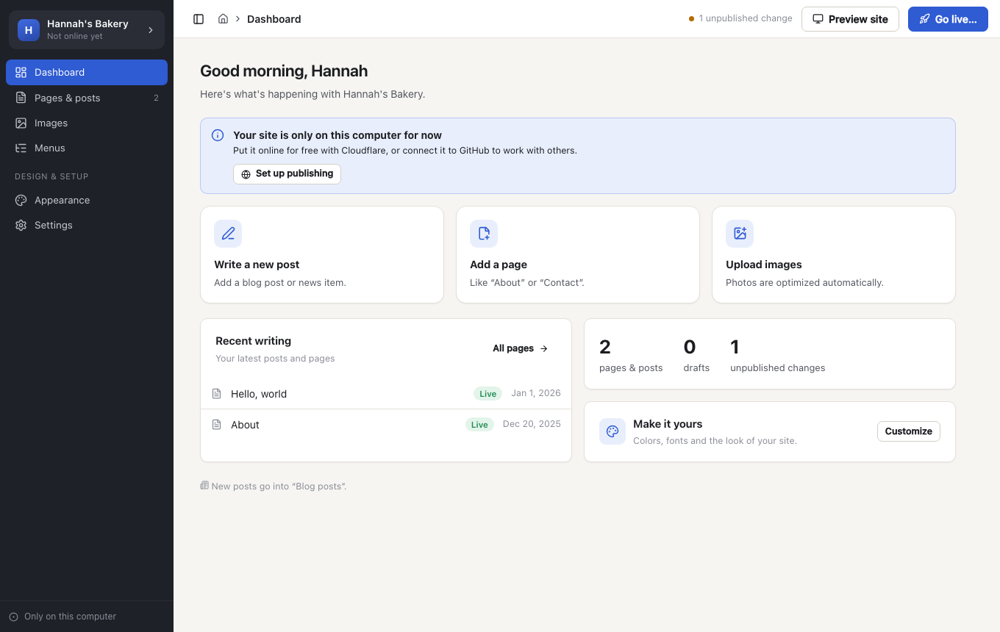
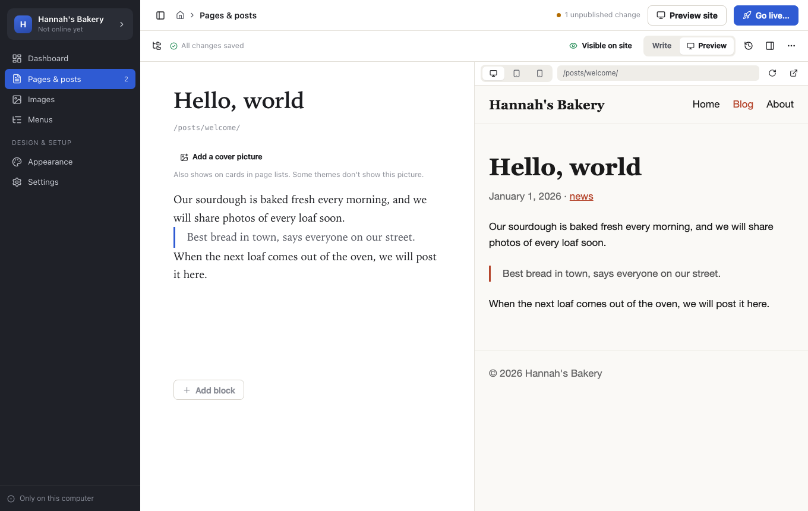
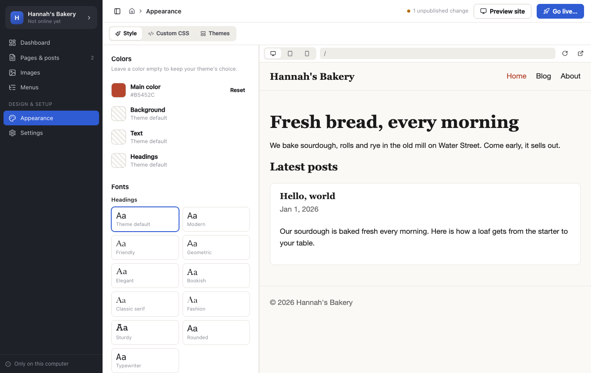
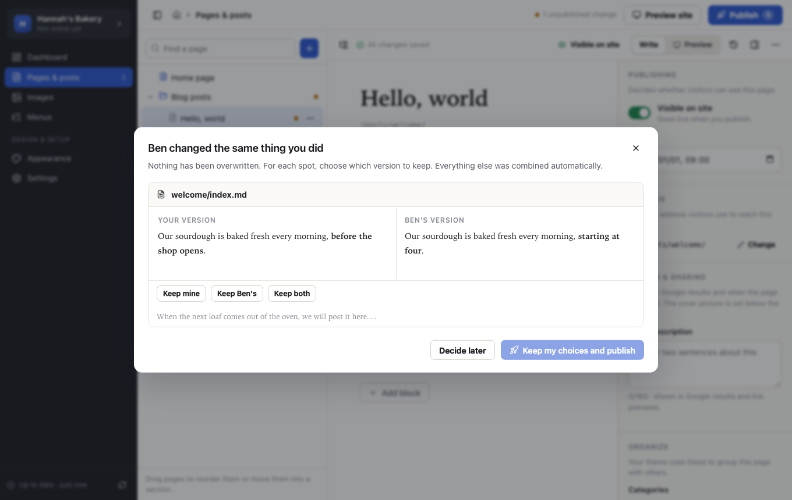

# Pageroom

A desktop editor for Hugo sites. You write pages, manage images and publish without touching Markdown, front matter or the command line.



Pageroom is for people who are used to the WordPress dashboard or a word processor. They open their site, click a page, type, and press Publish. Underneath it is an ordinary Hugo site in git, so developers keep full control.

Designed and verified by experienced human developers. Built with help from Claude.

## Download

Get the latest build for macOS, Windows or Linux from [GitHub Releases](https://github.com/myrheimb/pageroom/releases/latest). The builds aren't signed yet, so you will see a warning the first time you open one.

- macOS: download the file ending in `-mac.dmg`. The app isn't notarized, so macOS says it can't verify it. Open System Settings, then Privacy & Security, and choose Open Anyway.
- Windows: download the file ending in `-windows-setup.exe`. SmartScreen says Windows protected your PC. Choose More info, then Run anyway.
- Linux: download the `.deb` for Ubuntu, Debian or Linux Mint, the `.rpm` for Fedora or openSUSE, or the `.AppImage` for anything else. Make the AppImage executable with `chmod +x` before you run it.

To check a download, run `shasum -a 256 -c SHA256SUMS --ignore-missing` next to the file and `SHA256SUMS` from the release.

## What it does

- Write: a block editor. Type `/` for headings, lists, images, YouTube videos, buttons, contact forms and tables. Edits save on your computer as you type.
- Organize: a page tree you can drag to reorder or move between sections. Moved and renamed pages get Hugo aliases, so old addresses keep working.
- Images: drag photos onto the window. Large photos are resized and camera and GPS data is removed. The editor asks for a description for screen readers.
- Preview: the real site, rendered by Hugo on your computer, at desktop, tablet and phone sizes.
- Menus: pick pages and links, drag to reorder, indent to make dropdowns.
- Appearance: colors, fonts, text size and roundness, custom CSS, and a gallery of themes from themes.gohugo.io that you can try on your own pages and then keep or undo. The theme switcher test-builds your site first and warns about what changes.
- Publish: one button. Teammates' changes are merged with yours and nothing is overwritten. Pageroom can set up hosting on Cloudflare or GitHub Pages, or you can publish to a host that builds the site itself, such as Netlify. If you work alone, it can upload the site to Cloudflare with no GitHub account.
- History: every published version of every page, with restore.
- Move from WordPress: import an export file with posts, pages, categories, tags, images, files, embeds, forms, menus, the site icon and the look of the old theme. Old links redirect.
- Languages: English and Japanese. Pageroom follows your computer's language, or you can choose in Settings.
- Start fresh: with no site yet, Pageroom creates one with four built-in themes that switch instantly. Hundreds more are in the gallery.

| | |
|---|---|
|  |  |
|  |  |

## Safety

- Publishing never force-pushes. If someone published a moment earlier, Pageroom fetches their work, merges it paragraph by paragraph and tries again. If two people changed the same sentence, each sees both versions and chooses. Nothing on disk changes until they do.
- Saves are atomic. If a page changed on disk while you were editing it, Pageroom asks instead of overwriting.
- Sign-ins live in the OS keychain, never in files, logs or the UI. Publishing is blocked if a file looks like it contains a password, API key or private key.
- Editing is lossless. Front matter keeps its comments, key order and format (YAML, TOML or JSON), and unchanged files stay byte-for-byte identical. Shortcodes and raw HTML show as locked blocks.
- Hugo's preview listens on `127.0.0.1` only, and theme JavaScript runs in an iframe from another origin.

See [SECURITY.md](.github/SECURITY.md) for the threat model and how to report a vulnerability.

## What Pageroom connects to

- Your git host, when you sign in, get the latest changes or publish.
- GitHub, once per run, to check whether a newer release exists. It sends nothing else and never downloads an update by itself.
- GitHub, when your site needs a version of Hugo that isn't installed. Pageroom asks first, then downloads it into its own cache folder.
- Cloudflare, only if you publish to it.
- The WordPress site and Google Fonts, only when you import from WordPress.
- GitHub, when you install a theme from the gallery. The list of themes is built into the app.

## For developers who set up sites

Pageroom works with existing Hugo sites as they are. To tailor the editor with friendly section names, extra fields or a Hugo version, commit a `.pageroom.yaml`. See [site-config.md](docs/site-config.md).

## Building

You need Go 1.26+, Node 22+ and the [Wails v3 CLI](https://v3.wails.io/getting-started/installation/) (run `go install tool` in the repository to get the version in `go.mod`). On Linux you also need `libgtk-4-dev` and `libwebkitgtk-6.0-dev`. Alternatively, run `devenv shell` ([devenv](https://devenv.sh)), which provides these plus Hugo and installs the git hooks.

```sh
wails3 dev                      # run with hot reload
wails3 build                    # build for this platform into bin/
wails3 package                  # .app, NSIS installer, or AppImage/.deb/.rpm
```

Tests:

```sh
go test -race ./...             # Go (preview and import tests run when `hugo` is installed)
cd frontend && npx vitest run   # Markdown round-trip tests
```

In the devenv shell, `task test` runs both, `task type` typechecks the frontend, and `task lint` runs the git hooks on every file. `task screenshots` regenerates the images in `docs/screenshots/` from a mock of the app. A map of the code is in [architecture.md](docs/architecture.md).

## Status

Pageroom is early software. It supports Hugo sites in git (GitHub, GitLab, Bitbucket, Gitea or any host over HTTPS or SSH), or published straight to Cloudflare from your computer, on macOS, Windows and Linux. Planned: importing from a live WordPress site, editor and admin roles, Git LFS, and other static site generators.

## License

MIT
